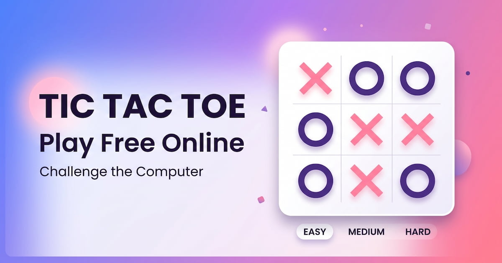

# Tic Tac Toe Online: Play Free vs Computer (Easy, Medium, Hard)

[](https://tic-tac-toe-three-mu-94.vercel.app/)


A free, fast **Tic Tac Toe game** that runs in your browser. Play against the computer on **Easy, Medium or Hard** difficulty, choose X or O, and play instantly on phone or desktop. No download, no signup.

**[▶ Play Tic Tac Toe online](https://tic-tac-toe-three-mu-94.vercel.app/)**



## Features

- **Three difficulty levels:** Easy, Medium and Hard (unbeatable minimax AI)
- **Play as X or O:** X always moves first; if you pick O, the computer opens
- **Win and draw animations:** the winning line is highlighted
- **Responsive design:** works on phones, tablets and desktops
- **Zero dependencies:** plain HTML, CSS and JavaScript
- **SEO-ready:** structured data (JSON-LD), Open Graph and Twitter cards, sitemap and robots.txt
- **Accessible:** ARIA labels, keyboard focus styles and reduced-motion support

## Difficulty Levels

| Level | How the computer plays | Can you win? |
|-------|------------------------|--------------|
| Easy | Picks random empty squares | Yes, easily |
| Medium | 70% of the time it wins, blocks or takes the center; 30% random | Yes, with a fork |
| Hard | Minimax algorithm, evaluates every possible game | No, the best result is a draw |

## How the AI Works

- **Easy** uses a random move generator.
- **Medium** checks one move ahead: win if possible, block the opponent's winning move, otherwise take the center or a random square. A random move 30% of the time keeps it beatable.
- **Hard** uses the [minimax algorithm](https://en.wikipedia.org/wiki/Minimax), which searches the full game tree and picks the move with the best guaranteed outcome. It chooses randomly among equally good moves so games do not repeat.

## How to Play

1. Choose a difficulty.
2. Choose to play as X or O.
3. Click an empty square to place your mark.
4. Get three in a row, column or diagonal to win.
5. If all nine squares fill up with no winner, the game is a draw.

## Run Locally

No build step is needed.

```bash
git clone https://github.com/x-hamza47/tic-tac-toe.git
cd tic-tac-toe
```

Then open `index.html` in your browser, or serve the folder with any static server:

```bash
npx serve .
```

## Project Structure

```text
tic-tac-toe/
├── index.html      # Markup, SEO meta tags and structured data
├── style.css       # Styles, animations and responsive layout
├── main.js         # Game logic and AI (random, rule-based, minimax)
├── og-image.jpg    # Social preview image (1200x630)
├── robots.txt
├── sitemap.xml
└── favicon/        # Icons, web manifest and browserconfig
```

## Tech Stack

HTML5, CSS3, vanilla JavaScript, Font Awesome icons, hosted on Vercel.

## Deployment

The site is deployed on [Vercel](https://vercel.com). Every push to the `master` branch redeploys automatically.

## Author

Built by **[Hamza Aamir](https://hamzaamir-portfolio.web.app/)**, software engineer.

- Portfolio: [hamzaamir-portfolio.web.app](https://hamzaamir-portfolio.web.app/)
- GitHub: [@x-hamza47](https://github.com/x-hamza47)
- LinkedIn: [hamza-aamir-dev](https://www.linkedin.com/in/hamza-aamir-dev/)

## Contributing

Issues and pull requests are welcome. Ideas for new features: score tracking, two-player mode, sound effects, themes.

## License

Released under the [MIT License](LICENSE).

---

**Keywords:** tic tac toe, tic tac toe online, play tic tac toe, tic tac toe vs computer, tic tac toe minimax, unbeatable tic tac toe AI, free browser game, JavaScript game
